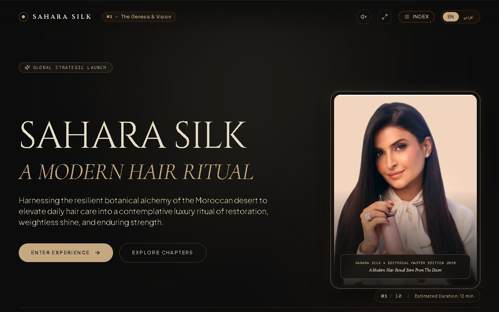

# Sahara Silk — A Modern Hair Ritual (Luxury Launch & Go-To-Market Experience)



🌐 **Live Presentation:** [sahara-silk-presentation.vercel.app](https://sahara-silk-presentation.vercel.app/)  
👨‍💻 **Frontend & Creative Technology:** [Mostafa Mohamed Farhat (Elshorbagy)](https://mostafa-portfolio-iota.vercel.app/)

---

## Overview

A 10-chapter luxury brand launch and go-to-market digital presentation crafted for **Sahara Silk Inc.** (*"A Modern Hair Ritual"*), combining obsidian and champagne-gold editorial art direction with interactive product storytelling.

### Key Features
- **10-Chapter Go-To-Market Narrative:** Covers brand philosophy, market positioning, formulation ritual, packaging identity, and launch rollout.
- **Interactive 3-Step Product Ritual Explorer:** Step-by-step interactive breakdown of the haircare ritual.
- **Sensory Presentation Controls:** Animated splash introduction, ambient audio toggle, chapter index drawer, bilingual EN/AR switching, and fullscreen presentation mode.

---

## Tech Stack
- **Framework:** React + Vite
- **Styling:** Tailwind CSS
- **Deployment:** Vercel

---

## Local Development

```bash
npm install
npm run dev
npm run build
```
